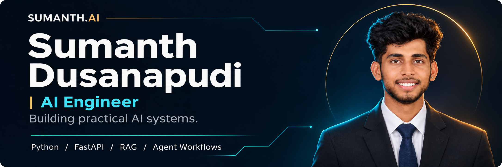
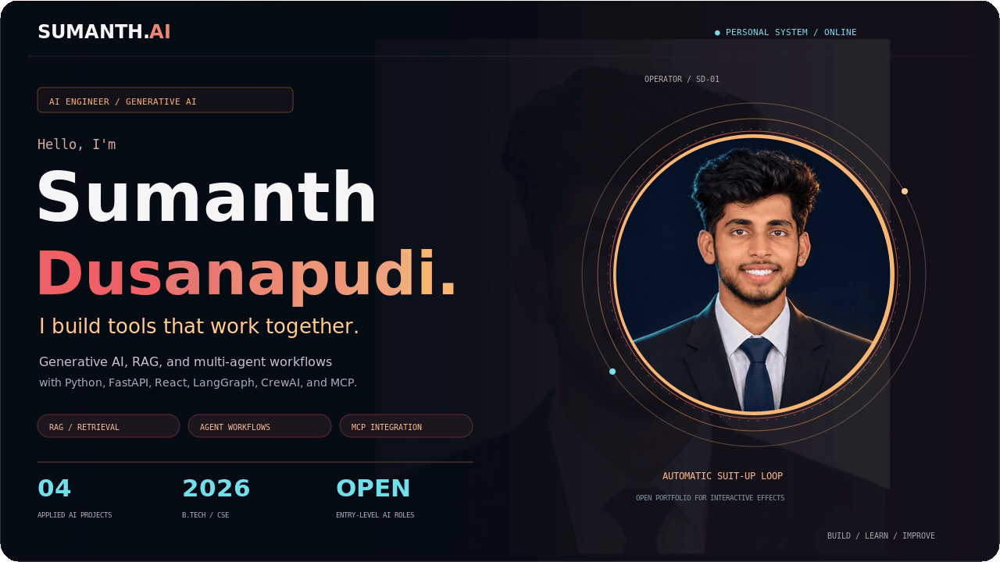
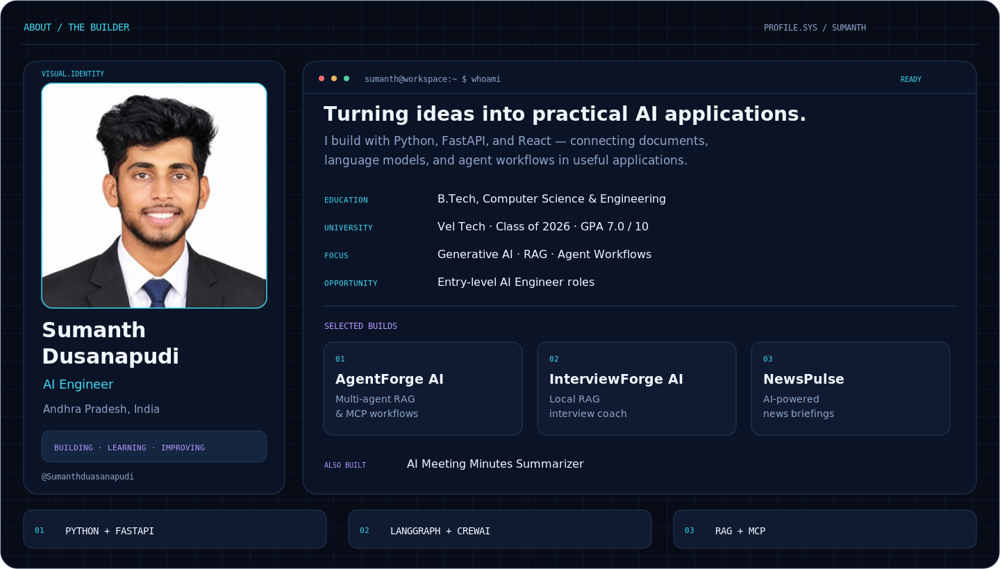
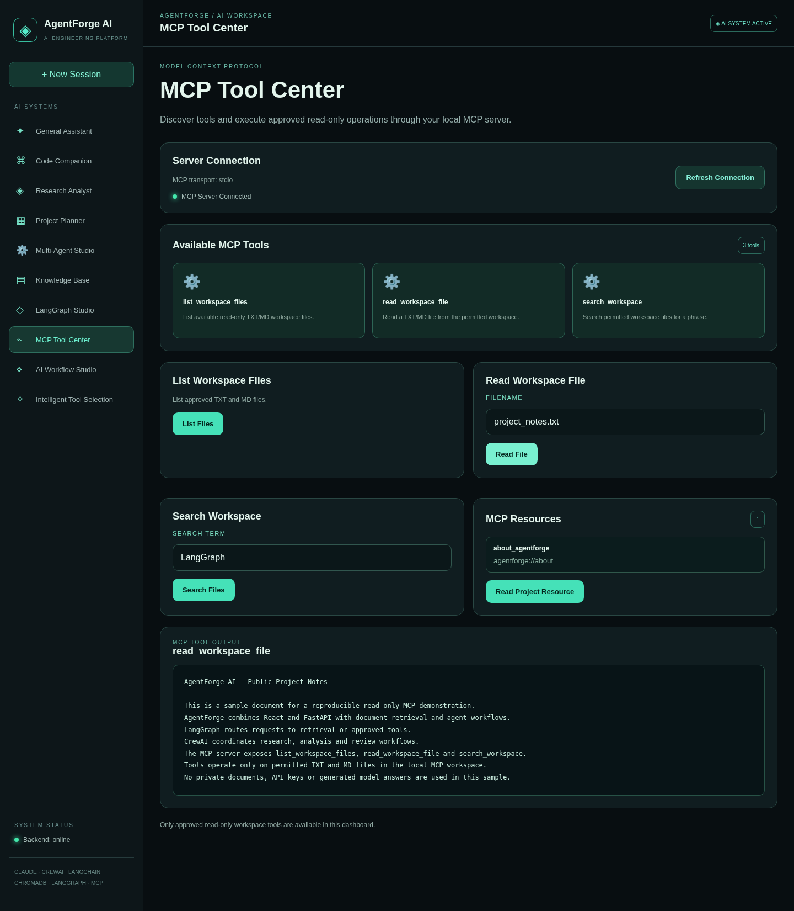
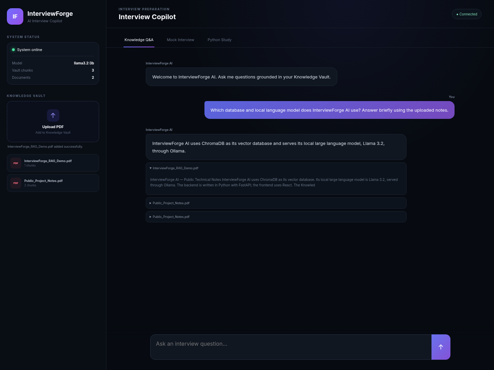
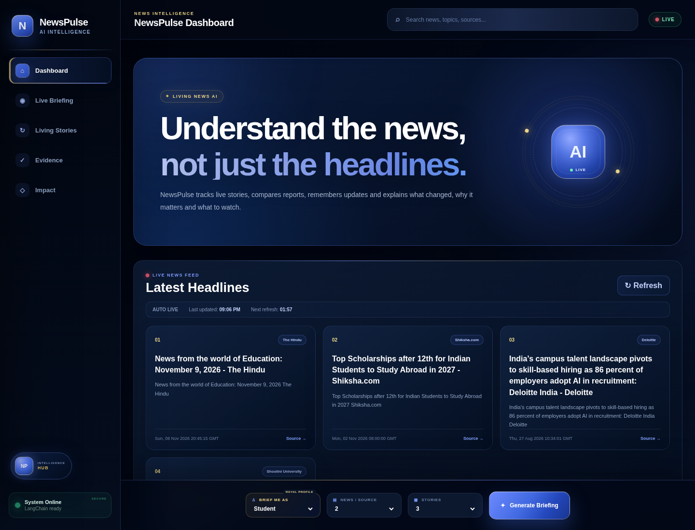
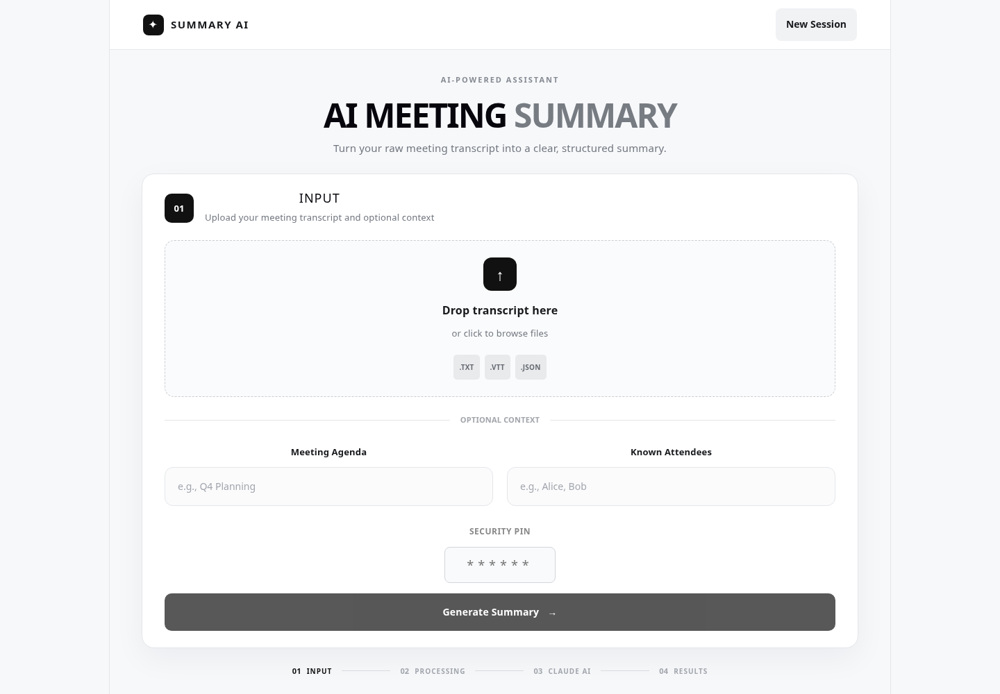

  
  
AI-assisted portrait banner · <a href="https://sumanth-ai-system-profile.vercel.app/">Open my portfolio for interactive effects ↗</a>

   

  
<b>AI Engineer · Generative AI · Agentic AI · RAG</b>

  

  

    
    
    
    
  

  <a href="#project-evidence">EVIDENCE</a> &nbsp; / &nbsp; <a href="#about-me">ABOUT</a> &nbsp; / &nbsp; <a href="#selected-projects">PROJECTS</a> &nbsp; / &nbsp; <a href="#my-toolkit">TOOLKIT</a> &nbsp; / &nbsp; <a href="#education--certifications">EDUCATION</a> &nbsp; / &nbsp; <a href="#github-activity">ACTIVITY</a>

<b>View the animated suit-up banner</b>

<picture>
      <source media="(prefers-reduced-motion: reduce)" srcset="./assets/suitup-static.png">
      
    </picture>

AI-generated suit-up preview · Loops automatically on GitHub · <a href="https://sumanth-ai-system-profile.vercel.app/">Open the interactive portfolio ↗</a>

 

## Project Evidence

**Entry-level AI Engineer · 2026 CSE graduate · Python, FastAPI, React, RAG, LangGraph, CrewAI and MCP.**

| Project | Start here | Demonstrated in this capture |
| :--- | :--- | :--- |
| **AgentForge AI** | [Recording & run instructions](./docs/demos/agentforge.md) · [Source](https://github.com/Sumanthduasanapudi/AgentForge) | Real MCP discovery, file reading and search |
| **InterviewForge AI** | [Recording & run instructions](./docs/demos/interviewforge.md) · [Real model response](./docs/demos/interviewforge-live-result.json) · [Source](https://github.com/Sumanthduasanapudi/InterviewForge-AI) | Real RAG answer with sources · [5-question scoring flow & measurements](./docs/demos/interviewforge-evaluation.md) |
| **NewsPulse** | [Screenshot](./assets/projects/newspulse-live-feed.png) · [Source](https://github.com/Sumanthduasanapudi/newspulse-ai) | Live RSS collection in the actual interface |
| **Meeting Minutes** | [Open demo](https://ai-meeting-summary-dun.vercel.app/) | Transcript-upload interface loads; summary generation requires its configured access |

[**Download ATS résumé (PDF)**](https://raw.githubusercontent.com/Sumanthduasanapudi/Sumanthduasanapudi/main/resume/Sumanth_Dusanapudi_AI_Engineer_ATS.pdf) · [Portfolio](https://sumanth-ai-system-profile.vercel.app/) · [Email](mailto:dusanapudisumanth@gmail.com)

These recordings verify the listed local flows. InterviewForge includes a real model-generated answer; AgentForge’s Claude answer remains pending. [Capture scope](./docs/demos/evidence.md) · [Full-answer verification steps](./docs/demos/next-verification.md).

## About Me

I'm **Sumanth Dusanapudi**, a **Computer Science and Engineering graduate (2026)** from Vel Tech, seeking an **entry-level AI Engineer role**.

I've built **four Generative AI applications** using **Python, FastAPI, and React**, covering **Retrieval-Augmented Generation (RAG), multi-agent workflows, local Large Language Models (LLMs), and structured summarization**. My work includes AgentForge AI, InterviewForge AI, NewsPulse, and an AI Meeting Minutes Summarizer.

<b>View my visual profile</b>

<picture>
  <source media="(prefers-color-scheme: light)" srcset="./assets/about-v2-light.png">
  
</picture>

## Selected Projects

> Four projects. A shared focus: connecting language models to useful, well-defined workflows.

**Start with the evidence:** [AgentForge recording](./docs/demos/agentforge.md) · [InterviewForge recording](./docs/demos/interviewforge.md) · [ATS résumé (PDF)](https://raw.githubusercontent.com/Sumanthduasanapudi/Sumanthduasanapudi/main/resume/Sumanth_Dusanapudi_AI_Engineer_ATS.pdf)

<b>01 &nbsp; AgentForge AI</b> &nbsp; — &nbsp; Multi-Agent RAG & MCP Platform

 

A React and FastAPI workspace that uses **LangGraph** to route requests to document retrieval or **MCP tools**, with **CrewAI** agents coordinating research, analysis, and review.

**Built with:** `Python` `FastAPI` `React` `LangGraph` `CrewAI` `RAG` `MCP`

[**Watch the recorded MCP workflow ↗**](./docs/demos/agentforge.md) · [Source & architecture ↗](https://github.com/Sumanthduasanapudi/AgentForge)

Actual local capture: read-only MCP discovery, file reading, and search. This recording uses an MCP-only runner; it does not claim completed model-generated answers.

<b>02 &nbsp; InterviewForge AI</b> &nbsp; — &nbsp; Local RAG Interview Coach

 

An interview-preparation app with **document Q&A, mock interviews, and Python study**, using **ChromaDB** and **Llama 3.2 through Ollama**.

- Implemented PDF ingestion, chunking, embeddings, and **persistent ChromaDB storage**.
- Retrieved the **top 3 chunks** to ground **Llama 3.2** answers through **Ollama**.
- Implemented adaptive **5-question practice sessions** with **0–10 scores**, feedback, and hints.

**Built with:** `Python` `FastAPI` `React` `ChromaDB` `Ollama` `Llama 3.2`

**Measured smoke test:** 6/6 factual answers correct, 2/2 unsupported questions declined, relevant passage ranked first in 6/6 cases; median response **6.41 s** on CPU. Small set: two PDFs, three chunks. [Method, raw results & full interview demo](./docs/demos/interviewforge-evaluation.md).

[**Watch the real PDF-to-answer demonstration ↗**](./docs/demos/interviewforge.md) · [Source & architecture ↗](https://github.com/Sumanthduasanapudi/InterviewForge-AI)

Actual local capture: PDF upload, retrieval, and a real Llama 3.2 answer with expanded sources. A separate unsupported-question check correctly declined to invent a salary. The full five-question scoring UI also completed; [evaluation results](./docs/demos/interviewforge-evaluation.md) document grading inconsistencies and repeated questions.

<b>03 &nbsp; NewsPulse</b> &nbsp; — &nbsp; AI News Briefing App

 

A React, Express.js, and FastAPI application that collects RSS articles, removes duplicates, groups related headlines by meaning, and generates briefings with **LangChain and Claude**.

- Implemented **controlled concurrent Claude API calls**, **Pydantic validation for structured outputs**, and optional **LangSmith tracing** for debugging.

**Built with:** `React` `Express.js` `FastAPI` `LangChain` `Claude API` `LangSmith`

[**View repository & architecture ↗**](https://github.com/Sumanthduasanapudi/newspulse-ai)

Actual local capture with the original RSS collector and a read-only runner. Saved example stories belong to the repository; Claude-generated briefings were not run during capture. [Capture scope](./docs/demos/evidence.md).

<b>04 &nbsp; AI Meeting Minutes Summarizer</b> &nbsp; — &nbsp; Transcript-to-Notes Workflow

 

**Turn meeting transcripts into concise notes.**

Integrated **Claude with FastAPI and Express.js** to convert transcripts in **3 formats—TXT, VTT, and JSON—into concise meeting notes**.

**Built with:** `Python` `FastAPI` `Express.js` `Claude API`

[**Open Meeting Minutes demo ↗**](https://ai-meeting-summary-dun.vercel.app/)

Screenshot of the public demo's input screen. The page loads; protected summary generation was not tested.

## My Toolkit

| Area | Tools I use |
| :--- | :--- |
| **Applications** | Python, FastAPI, React, Node.js, Express.js, REST APIs, SQL |
| **RAG & agents** | LangChain, LangGraph, CrewAI, MCP, ChromaDB, SentenceTransformers |
| **Models & tooling** | Claude API, Ollama / Llama 3.2, Pydantic, LangSmith, Git, Postman |

---

## Education & Certifications

| Education | Details |
| :--- | :--- |
| **B.Tech · Computer Science and Engineering** | Vel Tech · **2026** · GPA **7.0 / 10** |
| **Diploma · Mechanical Engineering** | S.M.V.M. Polytechnic, Tanuku · **2023** · **67%** |

**Learning credentials**

- **Introduction to LangChain** — LangChain Academy
- **Generative AI Fundamentals** — Databricks
- **Introduction to Model Context Protocol** — Anthropic
- **Introduction to LangGraph — Python**

---

## GitHub Activity

  
  

<picture>
  <source media="(prefers-color-scheme: light)" srcset="https://raw.githubusercontent.com/Sumanthduasanapudi/Sumanthduasanapudi/gh-pages/github-contribution-grid-snake.svg">
  
</picture>

---

### Let's build something useful.

**Seeking an entry-level AI Engineer role.**

<a href="https://sumanth-ai-system-profile.vercel.app/">Portfolio</a> &nbsp; / &nbsp;
<a href="https://www.linkedin.com/in/dusanapudi-sumanth-2925b3439/">LinkedIn</a> &nbsp; / &nbsp;
<a href="mailto:dusanapudisumanth@gmail.com">Email</a> &nbsp; / &nbsp;
<a href="https://github.com/Sumanthduasanapudi">GitHub</a>

Andhra Pradesh, India · Generative AI · Agentic AI · RAG

