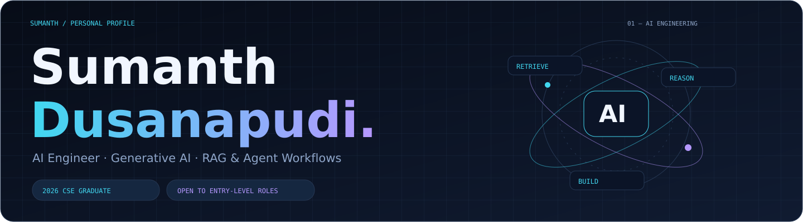

  <picture>
    <source media="(prefers-color-scheme: light)" srcset="./assets/hero-v2-light.svg">
    
  </picture>

   

  

  

    
    
    
  

  <a href="#about-me">ABOUT</a> &nbsp; / &nbsp; <a href="#selected-projects">PROJECTS</a> &nbsp; / &nbsp; <a href="#my-toolkit">TOOLKIT</a> &nbsp; / &nbsp; <a href="#education--certifications">EDUCATION</a> &nbsp; / &nbsp; <a href="#github-activity">ACTIVITY</a>

 

## About Me

<picture>
  <source media="(prefers-color-scheme: light)" srcset="./assets/about-v2-light.png">
  
</picture>

I'm **Sumanth Dusanapudi**, a **2026 Computer Science and Engineering graduate** from Vel Tech. I build Generative AI applications with **Python, FastAPI, and React**, with a focus on **retrieval-grounded answers, agent workflows, and useful interfaces**.

My projects include a multi-agent RAG platform, a local interview coach, an AI news briefing app, and a meeting-notes summarizer. I'm seeking an **entry-level AI Engineer / Generative AI Engineer** opportunity.

---

## Selected Projects

> Four projects. A shared focus: connecting language models to useful, well-defined workflows.

<b>01 &nbsp; AgentForge AI</b> &nbsp; — &nbsp; Multi-Agent RAG & MCP Platform

 

**Document Q&A and agent workflows in one application.**

A Python, FastAPI, and React platform that uses **LangGraph** to route requests to document retrieval or **MCP tools**, with **CrewAI** agents coordinating research, analysis, and review.

- Built document Q&A and multi-agent workflows in a unified application.
- Used LangGraph for retrieval and tool-routing flows.
- Coordinated CrewAI agents for research, analysis, and review tasks.

**Built with:** `Python` `FastAPI` `React` `LangGraph` `CrewAI` `RAG` `MCP`

[**View repository & architecture ↗**](https://github.com/Sumanthduasanapudi/AgentForge)

<b>02 &nbsp; InterviewForge AI</b> &nbsp; — &nbsp; Local RAG Interview Coach

 

**Your documents. Your practice sessions. A local language model.**

An interview-preparation app with **document Q&A, mock interviews, and Python study**, using **ChromaDB** and **Llama 3.2 through Ollama**.

- Implemented PDF ingestion, chunking, embeddings, and persistent vector storage.
- Retrieved the **three most relevant chunks** to ground local model responses.
- Built adaptive **five-question sessions** with **0–10 scores**, feedback, and hints.

**Built with:** `Python` `FastAPI` `React` `ChromaDB` `Ollama` `Llama 3.2`

[**View repository & architecture ↗**](https://github.com/Sumanthduasanapudi/InterviewForge-AI)

<b>03 &nbsp; NewsPulse</b> &nbsp; — &nbsp; AI News Briefing App

 

**Related headlines become structured briefings with sources.**

A React, Express.js, and FastAPI application that collects RSS articles, removes duplicates, groups related headlines by meaning, and generates briefings with **LangChain and Claude**.

- Built article deduplication and semantic headline grouping.
- Produced structured briefings with **source attribution**.
- Added controlled concurrent Claude calls, **Pydantic validation**, and optional **LangSmith tracing**.

**Built with:** `React` `Express.js` `FastAPI` `LangChain` `Claude API` `LangSmith`

[**View repository & architecture ↗**](https://github.com/Sumanthduasanapudi/newspulse-ai)

<b>04 &nbsp; AI Meeting Minutes Summarizer</b> &nbsp; — &nbsp; Transcript-to-Notes Workflow

 

**Turn meeting transcripts into concise notes.**

A FastAPI and Express.js workflow that uses Claude to summarize transcripts in **TXT, VTT, and JSON** formats.

**Built with:** `Python` `FastAPI` `Express.js` `Claude API`

---

## My Toolkit

### Application Development

### Generative AI & Agent Workflows

  
  
  
  
  
  

### Retrieval, Data & Developer Tools

  
  
  
  

 

| Focus | What I work with |
| :--- | :--- |
| **Grounded answers** | RAG, embeddings, semantic search, prompt engineering, and ChromaDB |
| **Agent workflows** | LangGraph, CrewAI, and Model Context Protocol |
| **Local inference** | Ollama and Llama 3.2 |
| **Application APIs** | Python, FastAPI, Node.js, Express.js, and REST APIs |
| **Interfaces** | React |
| **Validation & debugging** | Pydantic validation, optional LangSmith tracing, Git, and Postman |

---

## Education & Certifications

| Education | Details |
| :--- | :--- |
| **B.Tech · Computer Science and Engineering** | Vel Tech · **2026** · GPA **7.0 / 10** |
| **Diploma · Mechanical Engineering** | S.M.V.M. Polytechnic, Tanuku · **2023** · **67%** |

**Learning credentials**

- **Introduction to LangChain** — LangChain Academy
- **Generative AI Fundamentals** — Databricks
- **Introduction to Model Context Protocol** — Anthropic
- **Introduction to LangGraph — Python**

---

## GitHub Activity

  
  

<picture>
  <source media="(prefers-color-scheme: light)" srcset="https://raw.githubusercontent.com/Sumanthduasanapudi/Sumanthduasanapudi/gh-pages/github-contribution-grid-snake.svg">
  
</picture>

---

### Let's build something useful.

**Open to entry-level AI Engineer and Generative AI Engineer opportunities.**

<a href="https://sumanth-ai-system-profile.vercel.app/">Portfolio</a> &nbsp; / &nbsp;
<a href="https://www.linkedin.com/in/dusanapudi-sumanth-2925b3439/">LinkedIn</a> &nbsp; / &nbsp;
<a href="mailto:siddhusumanth2004@gmail.com">Email</a> &nbsp; / &nbsp;
<a href="https://github.com/Sumanthduasanapudi">GitHub</a>

Andhra Pradesh, India · Python · RAG · Agent Workflows

