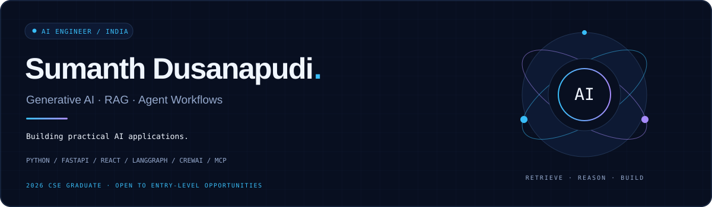
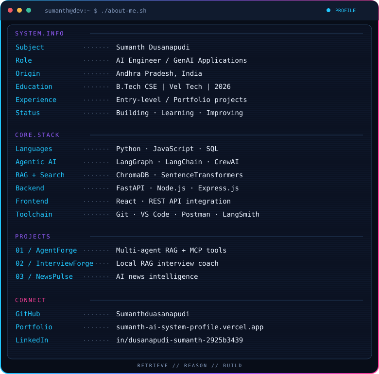
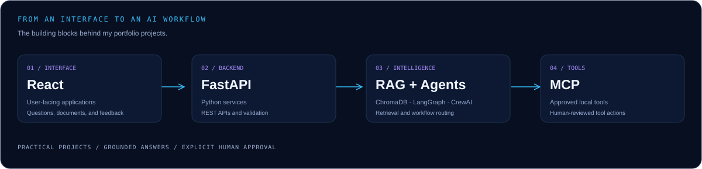

<div align="center">
  <picture>
    <source media="(prefers-color-scheme: light)" srcset="./assets/profile-header-light.svg">
    
  </picture>

  <a href="https://git.io/typing-svg"></a>

  <p>
    
    
    
    
  </p>

  <p>
    <a href="https://sumanth-ai-system-profile.vercel.app/"></a>
    <a href="https://www.linkedin.com/in/dusanapudi-sumanth-2925b3439/"></a>
    <a href="https://github.com/Sumanthduasanapudi?tab=repositories"></a>
  </p>

  <a href="#about-me">About</a> &nbsp;·&nbsp;
  <a href="#tech-stack">Tech stack</a> &nbsp;·&nbsp;
  <a href="#featured-projects">Projects</a> &nbsp;·&nbsp;
  <a href="#education--certifications">Education</a> &nbsp;·&nbsp;
  <a href="#github-activity">Activity</a>
</div>

---

## About Me

<table>
  <tr>
    <td width="36%" align="center" valign="top">
      <br>
      <b>VISUAL.MAP // SUMANTH</b>
      <br><br>
      <a href="https://github.com/Sumanthduasanapudi">
        
      </a>
      <br><br>
      <b>Sumanth Dusanapudi</b>
      <br>
      <sub>AI Engineer · Generative AI · RAG</sub>
      <br><br>
      
      <br>
      
      <br><br>
      <a href="https://sumanth-ai-system-profile.vercel.app/"><b>Portfolio ↗</b></a>
      &nbsp;·&nbsp;
      <a href="https://www.linkedin.com/in/dusanapudi-sumanth-2925b3439/"><b>LinkedIn ↗</b></a>
      <br><br>
    </td>
    <td width="64%" align="center" valign="top">
      <picture>
        <source media="(prefers-color-scheme: light)" srcset="./assets/about-system-light.svg">
        
      </picture>
    </td>
  </tr>
</table>

I'm **Sumanth Dusanapudi**, a 2026 Computer Science and Engineering graduate building AI applications with **Python, FastAPI, and React**. My projects bring together document retrieval, local language models, agent workflows, and API integrations.

- **Generative AI:** RAG, embeddings, semantic search, prompt engineering, and source-grounded answers.
- **Agent workflows:** LangGraph orchestration, CrewAI collaboration, and MCP tool integration.
- **Full-stack development:** Python and FastAPI services connected to React, Node.js, and Express.js.
- **What I'm looking for:** Entry-level **AI Engineer / Generative AI Engineer** roles and opportunities to build useful AI tools.

<picture>
  <source media="(prefers-color-scheme: light)" srcset="./assets/profile-map-light.svg">
  
</picture>

---

## Tech Stack

<div align="center">

### Languages & Application Development


### Generative AI & Agent Workflows

<p>
  
  
  
  
  
  
</p>

### Retrieval, Data & Developer Tools

<p>
  
  
  
  
</p>


</div>

---

## What I Build

| Area | Practical experience |
| :--- | :--- |
| **RAG & document Q&A** | PDF ingestion, chunking, embeddings, persistent ChromaDB storage, and semantic retrieval |
| **Agent orchestration** | LangGraph routing, CrewAI workflows, and human approval for AI-proposed tool actions |
| **Local AI applications** | Ollama and Llama 3.2 for document-grounded answers and interview practice |
| **AI-powered APIs** | FastAPI backends, React interfaces, and Node.js / Express.js API layers |
| **News intelligence** | RSS ingestion, article deduplication, semantic grouping, and structured briefings |
| **Validation & tracing** | Pydantic output validation and optional LangSmith tracing |

---

## Featured Projects

<details open>
<summary><b>01 · AgentForge AI — Multi-Agent RAG & MCP Platform</b></summary>

<br>

A local-first developer dashboard that brings **Claude chat, PDF retrieval, agent collaboration, and MCP tools** into one application.

```text
React Dashboard → FastAPI → LangGraph Routing
                              ├─ Document Retrieval → ChromaDB
                              ├─ CrewAI → Plan · Develop · Test · Review
                              └─ Human Approval → Read-only MCP Tools
```

| | |
| :--- | :--- |
| **Stack** | Python · FastAPI · React · Claude API · LangChain · LangGraph · CrewAI · ChromaDB · MCP |
| **Document workflow** | PDF ingestion, embeddings, retrieval, and source-referenced answers |
| **Agent workflow** | Planner, Developer, Tester, and Reviewer agents coordinate software-artifact generation |
| **Tool workflow** | AI-proposed tool selection with argument validation and explicit human approval |

[**Explore source & architecture →**](https://github.com/Sumanthduasanapudi/AgentForge)

</details>

<details>
<summary><b>02 · InterviewForge AI — Local RAG Interview Coach</b></summary>

<br>

An interview-preparation app with **document Q&A, mock interviews, and Python study**, running locally with Ollama.

```text
PDFs → Chunking → Embeddings → ChromaDB
                                  ↓
Question → Relevant Context → Ollama / Llama 3.2 → Answer & Feedback
```

| | |
| :--- | :--- |
| **Stack** | Python · FastAPI · React · ChromaDB · Ollama · Llama 3.2 · PyPDF |
| **Knowledge vault** | Persistent document storage and top-3 semantic retrieval |
| **Practice sessions** | Adaptive five-question sessions with scores, feedback, and hints |
| **Local inference** | Answers generated with Ollama rather than a hosted LLM API |

[**Explore source & architecture →**](https://github.com/Sumanthduasanapudi/InterviewForge-AI)

</details>

<details>
<summary><b>03 · NewsPulse AI — News Intelligence & Briefings</b></summary>

<br>

A full-stack app that collects RSS stories, groups related headlines, and produces **structured AI briefings with source attribution**.

```text
RSS Sources → Collection & Deduplication → Semantic Story Groups
                                                   ↓
React ← Express.js API Layer ← FastAPI + Claude Briefings
```

| | |
| :--- | :--- |
| **Stack** | React · Node.js · Express.js · Python · FastAPI · Claude · LangChain · SentenceTransformers |
| **Ingestion** | RSS collection, article deduplication, and semantic headline grouping |
| **AI layer** | Controlled concurrent Claude calls and structured news briefings |
| **Debugging** | Pydantic validation and optional LangSmith tracing |

[**Explore source & architecture →**](https://github.com/Sumanthduasanapudi/newspulse-ai)

</details>

<details>
<summary><b>04 · AI Meeting Minutes Summarizer</b></summary>

<br>

A transcript-processing workflow that turns **TXT, VTT, and JSON** transcripts into concise meeting notes using Claude.

**Stack:** Python · FastAPI · Node.js · Express.js · Claude API

- Supports several transcript formats.
- Connects Python and Node.js backend components.
- Produces AI-assisted meeting summaries.

</details>

---

## Education & Certifications

**B.Tech · Computer Science and Engineering**  
Vel Tech · Class of 2026 · GPA: **7.0 / 10**

**Diploma · Mechanical Engineering**  
S.M.V.M. Polytechnic, Tanuku · 2023

- **Introduction to LangChain** — LangChain Academy
- **Generative AI Fundamentals** — Databricks
- **Introduction to Model Context Protocol** — Anthropic
- **Introduction to LangGraph — Python**

---

## Current Focus

```yaml
building:
  - Retrieval-grounded AI applications
  - LangGraph and CrewAI workflows with MCP tools
  - Python APIs with practical React interfaces

developing:
  - Clearer source attribution and structured outputs
  - Reliable tool validation and human approval flows
  - Better debugging with LangSmith tracing

open_to:
  - Entry-level AI Engineer roles
  - Generative AI Engineer opportunities
  - RAG and agent-workflow collaborations
```

---

## GitHub Activity

<p align="center">
  <a href="https://github.com/Sumanthduasanapudi?tab=followers"></a>
  <a href="https://github.com/Sumanthduasanapudi?tab=repositories"></a>
</p>

<picture>
  <source media="(prefers-color-scheme: light)" srcset="https://raw.githubusercontent.com/Sumanthduasanapudi/Sumanthduasanapudi/gh-pages/github-contribution-grid-snake.svg">
  
</picture>

---

## Let's Connect

<div align="center">
  <p>Interested in practical AI applications, RAG, or agent workflows? I'd be happy to connect.</p>
  <a href="https://sumanth-ai-system-profile.vercel.app/"><b>Portfolio</b></a> &nbsp;·&nbsp;
  <a href="https://www.linkedin.com/in/dusanapudi-sumanth-2925b3439/"><b>LinkedIn</b></a> &nbsp;·&nbsp;
  <a href="https://github.com/Sumanthduasanapudi"><b>GitHub</b></a>
  <br><br>
  <sub>Building useful AI applications, one project at a time.</sub>
</div>
