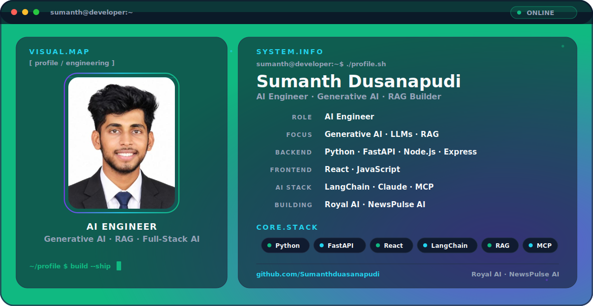

# Hi, I'm Sumanth Dusanapudi 👋

<picture>
  <source media="(prefers-color-scheme: dark)" srcset="./profile-hero-dark-v4.png">
  <source media="(prefers-color-scheme: light)" srcset="./profile-hero-light-v4.png">
  
</picture>

  <b>AI Engineer · Generative AI · RAG · Python & Backend APIs</b>

  Computer Science and Engineering graduate (2026) building end-to-end AI applications across RAG, LLM summarization, news intelligence, and backend APIs.

---

## 👨‍💻 About Me

- 🎓 B.Tech in Computer Science and Engineering, graduating in 2026
- 🤖 Focused on AI Engineering and Generative AI application development
- 🧠 Building with LLMs, RAG, embeddings, vector databases, and prompt engineering
- ⚙️ Developing AI backends with Python, FastAPI, Node.js, and Express.js
- 🌐 Integrating React frontends with multi-layer AI services and REST APIs
- 🔐 Learning production-minded API design, authentication, CORS, and secret management
- 🎯 Seeking a fresher **AI Engineer / Generative AI Engineer** opportunity

## 🌟 Featured Projects

### 🎯 InterviewForge AI — RAG-Powered Interview Preparation Platform

A fully local RAG application for technical interview preparation with **Knowledge Q&A, Mock Interview, and Python Study** modes.

**Tech:** Python · FastAPI · React · ChromaDB · Ollama · Llama 3.2 · PyPDF · RAG

**Highlights:**
- Built an end-to-end PDF ingestion, chunking, embedding, vector storage, and retrieval pipeline
- Implemented persistent ChromaDB storage and top-3 semantic retrieval
- Generated source-grounded answers locally using Llama 3.2 through Ollama
- Built adaptive 5-question interview and study sessions with scoring, feedback, hints, and improved answers

[View InterviewForge AI](https://github.com/Sumanthduasanapudi/InterviewForge-AI)

### 📰 NewsPulse — AI-Powered News Intelligence Platform

A 3-layer AI news application using **React → Express.js → FastAPI → Claude** for collecting, grouping, analyzing, and briefing news stories.

**Tech:** React · Node.js · Express.js · Python · FastAPI · LangChain · LangSmith · Claude API · RSS · Sentence Transformers

**Highlights:**
- Built RSS ingestion with article deduplication and semantic headline clustering
- Added multi-source attribution and structured AI-generated news briefings
- Replaced sequential LLM summarization with controlled concurrent Claude calls
- Added Pydantic-validated structured outputs and optional LangSmith tracing for observability and debugging
- Kept Claude credentials server-side with environment-based secret handling

[View NewsPulse](https://github.com/Sumanthduasanapudi/newspulse-ai)

### 📝 AI Meeting Minutes Summarizer

LLM-powered meeting workflow that converts **TXT, VTT, and JSON** transcripts into concise meeting notes.

**Tech:** Python · FastAPI · Node.js · Express.js · Axios · Claude API

**Highlights:**
- Supports multiple transcript formats
- Connects Python/FastAPI and Node.js/Express.js backend components
- Uses Claude API for AI-assisted transcript summarization

## 🧰 Technical Skills

**Programming:** Python · SQL  
**AI & Generative AI:** Generative AI · LLMs · Prompt Engineering · RAG · Embeddings · Vector Databases · LangChain · Machine Learning Fundamentals  
**AI Tools:** ChromaDB · Ollama · Llama 3.2 · Claude API · LangSmith · Sentence Transformers  
**Backend & API Security:** FastAPI · Node.js · Express.js · REST APIs · API Gateway · Bearer Token Authentication · CORS · Environment Variables · Secret Management  
**Frontend:** React.js · JavaScript · HTML5 · CSS3  
**Databases:** MySQL · Oracle  
**Tools:** Git · GitHub · Visual Studio Code · Postman  
**Core Concepts:** OOP · DBMS · API Integration · Data Structures Fundamentals · Problem-Solving

## 🎓 Education

**B.Tech — Computer Science and Engineering**  
Vel Tech Rangarajan Dr. Sagunthala R&D Institute of Science and Technology · 2026 · GPA: 7.0/10

## 📜 Certifications

- Introduction to LangChain — LangChain Academy (2026)
- Databricks Accredited Generative AI Fundamentals — Databricks Academy (2026)
- Introduction to Model Context Protocol — Anthropic
- Introduction to LangGraph — Python (2026)

## 📈 GitHub Activity

  <picture>
    <source media="(prefers-color-scheme: dark)" srcset="https://raw.githubusercontent.com/Sumanthduasanapudi/Sumanthduasanapudi/gh-pages/github-contribution-grid-snake-dark.svg">
    <source media="(prefers-color-scheme: light)" srcset="https://raw.githubusercontent.com/Sumanthduasanapudi/Sumanthduasanapudi/gh-pages/github-contribution-grid-snake.svg">
    
  </picture>

## 🔗 Connect

- LinkedIn: [Dusanapudi Sumanth](https://www.linkedin.com/in/dusanapudi-sumanth-2925b3439/)
- GitHub: [@Sumanthduasanapudi](https://github.com/Sumanthduasanapudi)

---

<b>Building practical AI systems · Learning continuously · Growing as an AI Engineer</b>

