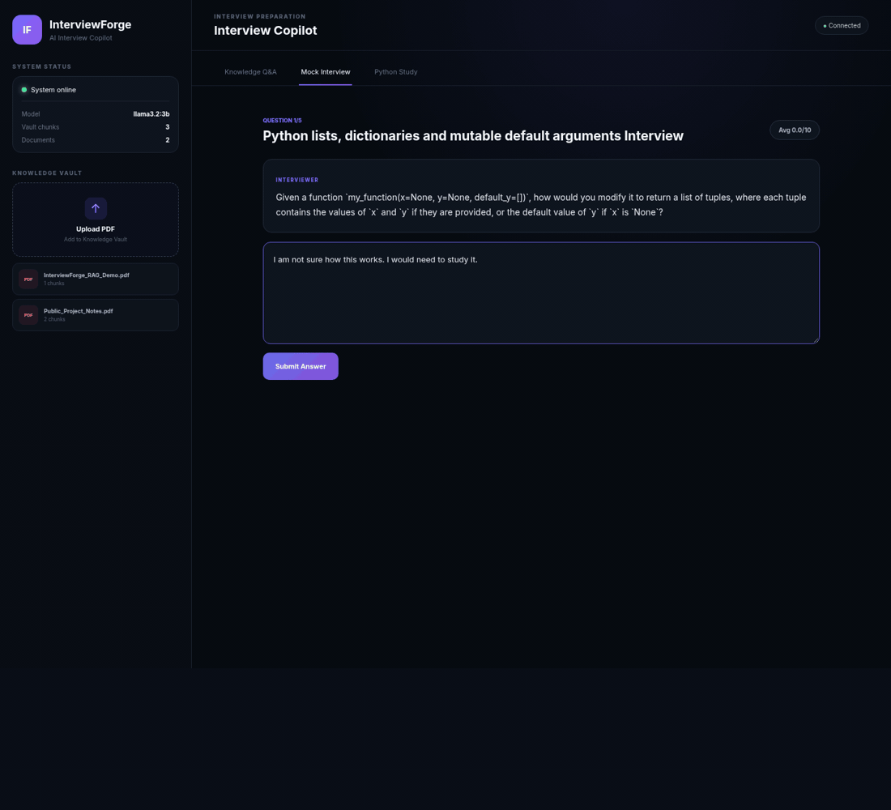

# InterviewForge: mock-interview flow and measured RAG evaluation

This report separates a working interview flow from model quality. It uses the original project at [`f99f70d`](https://github.com/Sumanthduasanapudi/InterviewForge-AI/tree/f99f70dc73799937cb3e6173cbe73cd8f3e34273), original React UI and FastAPI routes, and actual local Ollama generation. No API responses were mocked and no project implementation changes were needed for this run.

## Five-question mock interview

The candidate answers are explicitly **scripted demonstration inputs**, not Sumanth’s interview performance. The first answer deliberately admits uncertainty; subsequent answers explain Python concepts. All questions, answers, scores, feedback and timings are preserved in the [raw session result](./mock-interview-result.json).



[Full completion screenshot](../../assets/projects/interviewforge-mock-complete.png)

**Completed:** five submitted answers, all six numeric score categories within 0–10, nonempty feedback and improved answers on every round, four generated follow-ups, no sixth question, and final UI completion. Browser page errors: **0**. Only **2 of 5 questions were unique**.

The scripted demo scores were **2, 8, 8, 8, 7**, with a correctly displayed arithmetic average of **6.6/10**. These are model outputs, not a candidate-performance claim.

| Stage | Observed end-to-end seconds |
| :--- | ---: |
| Generate first question | 38.88 |
| Evaluate round 1 + generate next question | 122.11 |
| Evaluate round 2 + generate next question | 100.88 |
| Evaluate round 3 + generate next question | 71.71 |
| Evaluate round 4 + generate next question | 65.89 |
| Evaluate round 5 | 51.60 |


The animation is an edited sequence of actual UI screenshots. It omits generation waits; it is not a real-time performance recording. The JSON records real elapsed times.

### Quality findings

The first answer was “I am not sure how this works. I would need to study it.” The model assigned 2/10 overall but 8/10 for technical depth, and credited understanding and a solution the answer did not contain. Its suggested code retained a mutable default and had identical branch results. This is a genuine grading defect, not a successful accuracy result.

The first follow-up added an empty-list case to the original question. The next follow-up repeated the previous question verbatim. Context was passed through the workflow, but the observed adaptation was limited and repetitive. Model-assigned scores are not a validated measure of candidate ability.

## Small document-Q&A evaluation

| Measure | Observed result |
| :--- | :--- |
| Answerable factual questions, manually reviewed | **6/6 correct (100%) on these cases** |
| Unsupported questions correctly declined | **2/2** |
| Relevant technical-notes chunk ranked first | **6/6**, top-1 hit rate 100% |
| Mean reciprocal rank on the six answerable queries | **1.00** |
| End-to-end response time, median | **6.41 seconds** |
| End-to-end response time, mean | **9.61 seconds** |
| End-to-end response time, range | **4.88–22.85 seconds** |
| Nearest-rank p95 (n=8; equals maximum) | **22.85 seconds** |

All eight full answers were reviewed against the source PDFs. No contradictions were observed in the six short factual responses; both unsupported cases explicitly declined. This result applies to these fixed cases only. [Plan defined before execution](./interviewforge-evaluation-plan.md).

| Case | Answer/retrieval check | Seconds |
| :--- | :--- | ---: |
| database | Correct fact; relevant chunk #1 | 22.85 |
| model | Correct fact; relevant chunk #1 | 7.43 |
| backend | Correct fact; relevant chunk #1 | 4.88 |
| retrieval | Correct fact; relevant chunk #1 | 5.39 |
| session | Correct fact; relevant chunk #1 | 5.10 |
| scores | Correct fact; relevant chunk #1 | 5.12 |
| salary | Appropriate refusal | 13.50 |
| employer | Appropriate refusal | 12.61 |


### Method and limits

- Six answerable questions and two unsupported questions, fixed before the run. [Executable cases and checks](./evaluate_interviewforge.py) · [Raw responses and timings](./interviewforge-rag-evaluation.json).
- The answerable cases cover database, model/server, backend stack, retrieval count, practice length and score range. Unsupported cases ask for salary and a production employer.
- Automatic checks require the documented fact terms; complete answers are also manually reviewed for contradictions. Refusal cases are reported separately from answerable facts.
- Retrieval is the rank of the known relevant `InterviewForge_RAG_Demo.pdf` chunk 0: top-1 hit rate and mean reciprocal rank on the six answerable cases.
- Corpus: **two public PDFs, three chunks total**. Top-3 includes the entire corpus, so it is deliberately not presented as a meaningful recall result. This is a small smoke evaluation, not a held-out or production benchmark.
- Latency uses Python `time.perf_counter` around the original `/ask` HTTP request, including retrieval and complete non-streaming generation. Requests are serial, one run per case, with the model warm after interview use. The small sample makes percentiles unstable.
- Runtime: Ollama 0.40.15, `llama3.2:3b` Q4_K_M, 4096-token context, CPU only, three vCPUs (Intel Xeon Platinum 8573C), approximately 9.7 GiB host RAM. Results depend on this hardware and prompt.

## Reproduce

Start the original API, frontend and Ollama using the [existing instructions](./interviewforge.md). Upload both [public project notes](./Public_Project_Notes.pdf) and [focused technical notes](./InterviewForge_RAG_Demo.pdf). Keep one API process per Chroma directory.

From the profile checkout:

```bash
python docs/demos/evaluate_interviewforge.py --output interviewforge-rag-evaluation.json
```

For the UI session, install Playwright, make Chromium available at `/usr/bin/chromium` (or adjust that executable path for your machine), and run:

```bash
node docs/demos/record_mock_interview.cjs
```

The UI runner supplies scripted candidate answers and saves real request results and screenshots. Model generation is stochastic; later scores and wording can differ.

The next improvement should be a stricter, evidence-based grading rubric and duplicate-question prevention, followed by a larger document set with genuine retrieval distractors and human-labelled answer checks.
